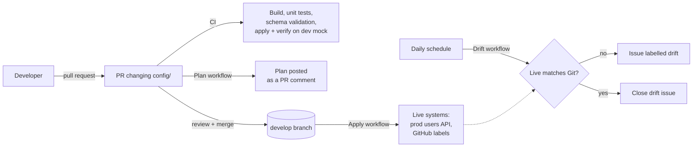

# GitOps for Infrastructure as Code with Java, Gradle and RESTAssured

This repository manages live systems from Git. The desired state of each system is a set of JSON files under `config/`. A small Java tool (built with Gradle, talking to APIs through RESTAssured) compares that desired state with what is actually running, shows the difference as a plan, and applies it. GitHub Actions runs the tool on every pull request, on every merge and once a day, so Git stays the single source of truth.

Two kinds of system are managed today:

| Target | What it manages | Live system |
|---|---|---|
| `dev` | users | the [json-server](https://github.com/typicode/json-server) mock in `mock/` |
| `prod` | users | [JSONPlaceholder](https://jsonplaceholder.typicode.com) |
| `github` | issue labels | this repository, via the GitHub REST API |

The users API is a stand-in for any configuration service (tenants, feature flags, accounts). The labels target shows the same loop working against a real system.

## How it works



1. **Change Git, not the live system.** Edit, add or delete a file in `config/<target>/<kind>/` and open a pull request.
2. **CI** compiles, runs the tests, validates every config file against its JSON Schema, and runs a full apply against a throwaway mock API, failing if any drift remains afterwards.
3. **Plan** comments on the PR with exactly what will be created, updated or deleted in `prod` and `github`, like `terraform plan`.
4. **Apply** runs after merge and makes the live systems match Git. It runs in the `production` environment, so you can require an approval.
5. **Drift detection** runs every day. If someone changed a live system by hand, it opens an issue with the plan. It closes the issue again once Git and the live system agree.
6. **Promotion**: the *Promote dev to prod* workflow copies `config/dev/users` to `config/prod/users` and opens a PR, so prod changes are always reviewed and always tested in dev first.

## Repository layout

```
config/
  dev/      target.json + users/*.json      desired state of the dev users API
  prod/     target.json + users/*.json      desired state of the prod users API
  github/   target.json + labels/*.json     desired labels of this repository
mock/db.json                                seed data for the dev mock API
src/main/resources/schemas/                 JSON Schema for each kind of resource
src/main/java/gitops/                       plan / apply engine and CLI
src/main/java/gitops/providers/             one class per live system API
.github/workflows/                          ci, plan, apply, drift, promote
```

Each resource is one file named after its key (the `username` for users, the `name` for labels). For example, `config/prod/users/bret.json`:

```json
{
  "id": 15,
  "username": "Bret",
  "email": "Sincere@april.biz",
  "phone": "1-770-736-8031 x56442"
}
```

Only the fields declared in the schema are managed. Other fields on the live system (a user's address, a label's URL) are ignored.

`target.json` says where the live system is and how to treat it:

| Setting | Meaning |
|---|---|
| `kind` | `users` or `labels` |
| `baseUrl` (users) | API base URL. Can be overridden with the `GITOPS_BASE_URL` environment variable. |
| `repository` (labels) | `owner/name`. Uses `GITHUB_TOKEN` when set; required for apply. |
| `prune` | Delete live resources that aren't in Git. When off, they are listed as unmanaged and left alone. |
| `verifyAfterApply` | Re-plan after applying and fail if anything still differs. Off for `prod` because JSONPlaceholder accepts writes but never stores them. |

## Running it locally

You need JDK 21. The Gradle wrapper downloads Gradle itself.

```bash
./gradlew build                          # compile and run the tests
./gradlew validateConfig                 # check every config file against its schema

docker compose up -d                     # start the dev mock API on localhost:3000
./gradlew plan -Ptarget=dev              # what would change
./gradlew applyConfig -Ptarget=dev       # make the mock match Git
./gradlew detectDrift -Ptarget=dev       # fails if anything still differs

./gradlew plan -Ptarget=prod             # plan against JSONPlaceholder
./gradlew plan -Ptarget=github           # plan this repository's labels
./gradlew snapshot -Ptarget=prod         # import live state into Git (bootstrapping)
./gradlew fetch -Ptarget=prod            # print live state
./gradlew promote -Pfrom=dev -Pto=prod   # copy dev's desired state to prod
```

Without Docker, start the mock with `cp mock/db.json /tmp/db.json && npx json-server@0.17.4 --port 3000 /tmp/db.json`.

Extra CLI flags go through `-Pargs`, for example `./gradlew plan -Ptarget=prod -Pargs="--format markdown --out plan.md"`. The CLI exits with 0 on success, 1 on errors or invalid config, and 2 when `--fail-on-drift` finds drift.

Example plan:

```
Plan for target 'dev' (users @ http://localhost:3000)
  ~ update Bret
      id: 1 -> 15
  ~ update Elwyn.Skiles
      id: 7 -> 72
  + create Moriah.Stantonite
  - delete Moriah.Stanton
Plan: 1 to create, 2 to update, 1 to delete.
```

## Adding a new kind of resource

1. Add a schema at `src/main/resources/schemas/<kind>.schema.json`.
2. Add a value to `Kind` with the key field and any fields that must be unique.
3. Implement `Provider` (list, create, update, delete) for the API, and wire it up in `Target.provider()`.
4. Add `config/<target>/target.json` and the resource files, and add the target to the `apply` and `drift` workflow matrices.

## Repository settings to turn on

Some of the setup lives in GitHub settings rather than in files:

- **Branch protection** on `develop`: require pull requests, a review from code owners, and the *Build, test, validate* and *Apply and verify (dev mock)* checks.
- **Environment `production`** (Settings > Environments): add required reviewers so applies wait for approval. Without this, GitHub creates the environment with no protection on the first run.
- **Actions can create pull requests** (Settings > Actions > General), for the promotion workflow. Add a `PROMOTE_TOKEN` secret if you want CI to run on promotion PRs.

## Background

**Infrastructure as Code** manages systems through machine-readable definition files instead of manual configuration, so changes are repeatable, reviewable and consistent across environments.

**GitOps** uses Git as the single source of truth for that code. Every change goes through a pull request, an automated process makes the live system match what is merged, and drift from that state is detected and reported. This gives a full audit history of who changed what, when and why, and makes rollbacks a `git revert`.
