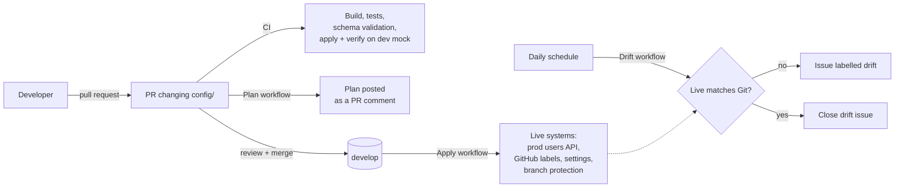

<div align="center">


# GitOps

**Keep the desired state of your systems in Git, see every change as a plan before it happens, and find out when the live system drifts.**

GitOps is a small infrastructure-as-code tool written in Java with Gradle and RESTAssured. The desired state of each system lives in JSON files under `config/`. The tool compares them with what is actually running, shows the difference as a plan, and applies it, and GitHub Actions runs it on every pull request, on every merge and once a day. Today it manages users in a JSONPlaceholder-style API (a stand-in for tenants, accounts or feature flags) and this repository's own GitHub setup: its issue labels, its settings and topics, and the protection rule on `develop`.

[How to use it](#how-to-use-it) · [Quick start](#quick-start) · [How it works](#how-it-works) · [Configuration](#configuration) · [Workflows](#workflows) · [Extending it](#extending-it)

[](https://github.com/emmanuelalozie/gitops/actions/workflows/ci.yml)    


</div>

## Why use it

- **Git is the only way in.** Every change is a file edited in a pull request, reviewed and merged, so the history of the repository is the history of the system: who changed what, when and why. Rolling back is a `git revert`.
- **You see the change before it happens.** A plan lists every resource that will be created, updated or deleted and every field that changes, not just the first difference. On a pull request it's posted as a comment, so reviewers approve the effect, not just the diff.
- **Bad config never reaches a live system.** Every file is checked against a JSON Schema, its file name must match its key, and ids must be unique. All problems are reported at once, and plan and apply refuse to run until they're fixed. A missing config folder is an error, and apply refuses to delete every live resource because Git has none unless you pass `--allow-delete-all`.
- **Apply checks its own work.** After applying, it plans again and fails if anything still differs, so a change that the API quietly ignored doesn't look like a success.
- **Drift gets noticed.** Once a day the live systems are compared with Git. If someone changed one by hand, an issue labelled `drift` opens with the plan, and it closes itself once they match again.
- **Changes are tested first.** `dev` runs against a local mock API that CI builds from scratch on every pull request, applies and verifies.
- **It only touches what it manages.** Only fields declared in the schema are compared, so a user's address or a label's URL is ignored. With `prune` off, live resources that aren't in Git are listed and left alone. Caveat: JSONPlaceholder, the `prod` users API, accepts writes but never stores them. Git matches its data today, but after any change to `config/prod/users` the apply can't be verified and the daily drift check keeps reporting that change, because JSONPlaceholder never keeps it. Pointing `prod` at an API that stores data fixes this.

## How to use it


1. **Change a file.** Edit, add or delete a JSON file in `config/<target>/<kind>/`, for example `config/dev/users/bret.json`. The file name is the key in lower case (see [Configuration](#configuration)).
2. **Check it locally.** `./gradlew validateConfig` checks the schemas, and `./gradlew plan -Ptarget=dev` shows what would change (see [Quick start](#quick-start)).
3. **Open a pull request.** CI builds, tests, validates and runs a full apply against the mock, and the Plan workflow comments with what will change in `prod` and `github`.
4. **Merge it.** The Apply workflow makes the live systems match Git, after an approval if the `production` environment asks for one.

<br clear="right" />

| Task | How |
| --- | --- |
| Add, change or remove a user | Edit `config/<env>/users/<username>.json` and open a pull request |
| Add or recolour a label of this repository | Edit `config/github/labels/<name>.json` |
| Check every config file | `./gradlew validateConfig` |
| See what would change | `./gradlew plan -Ptarget=<target>`, or the comment on the pull request |
| Fail a script or job if anything has drifted | `./gradlew detectDrift -Ptarget=<target>` |
| Make the live system match Git by hand | `./gradlew applyConfig -Ptarget=<target>`, or run the Apply workflow |
| Start managing a system that already has data | `./gradlew snapshot -Ptarget=<target>` writes its live state into Git |
| Look at the live state | `./gradlew fetch -Ptarget=<target>` |
| Check for drift now instead of waiting a day | Run the *Drift detection* workflow |

<details>
<summary><strong>Plans in one minute</strong></summary>

- **Resources are matched by key:** `username` for users, `name` for labels and repository settings, `branch` for protection rules. Changing a username is a delete of the old user and a create of the new one. Label names match regardless of case, as on GitHub, so changing only the case renames the label.
- **Actions:** `+ create` (in Git, not live), `~ update` (both, with the fields that differ) and `- delete` (live, not in Git, only when `prune` is on). With `prune` off, extra live resources are listed as unmanaged.
- **Order:** every delete runs first, then updates, then creates, so a freed key or id can be reused in the same apply, even when two users swap ids.
- **Users:** an update patches only the changed fields. A changed `id` can't be patched, so the user is replaced: deleted with the other deletes and created again with the other creates.
- **Lists** such as topics and required checks are compared as sets, because APIs return them in their own order.
- **Exit codes:** 0 for success, 1 for an error or invalid config, 2 when `--fail-on-drift` finds drift.

</details>

## Quick start

You need Java 17 or newer (Gradle downloads JDK 21 for the build if you don't have it) and, for the local demo, [Node.js](https://nodejs.org) or Docker. Gradle itself comes with the project. Not sure what's installed? Run the checker first:

```bash
git clone https://github.com/emmanuelalozie/gitops
cd gitops
./scripts/doctor.sh          # Windows PowerShell: .\scripts\doctor.ps1
```

It checks git, Java (and whether `JAVA_HOME` points at a different version than `java` on your PATH), Node.js and Docker, port 3000 and the download sites, and says exactly what to install, if anything.

Then try the whole loop with one command:

```bash
./gradlew demo               # Windows: .\gradlew.bat demo
```

It starts the mock users API from `mock/db.json` (with Node.js, or Docker if Node isn't installed), plans, applies and runs a drift check against the `dev` target, then stops the mock. The mock starts out as a live system someone edited by hand (Bret and Elwyn.Skiles have the wrong ids, Karianne's email and Maxime_Nienow's phone were changed, and Moriah.Stanton was renamed), so the plan shows six changes, the apply fixes them, and the drift check passes. Edit a file in `config/dev/users` and run it again to see your own change planned and applied.

The default branch is `develop`. To run the steps one at a time, start the mock yourself (`docker compose up -d`, or `cp mock/db.json /tmp/db.json && npx json-server@0.17.4 --port 3000 /tmp/db.json`) and use `./gradlew plan`, `applyConfig` and `detectDrift` with `-Ptarget=dev`. Both ways copy the seed first, so applying never edits `mock/db.json`.

<details>
<summary><strong>Development tools</strong></summary>

- **Tests** use JUnit 6, AssertJ and [WireMock](https://wiremock.org) for the APIs, so they never call a live system. The report is in `build/reports/tests/test/index.html`.
- **Extra CLI flags** go through `-Pargs`, for example `./gradlew plan -Ptarget=prod -Pargs="--format markdown --out plan.md"` for the Markdown the pull request comment uses.
- **Running the CLI directly:** `gitops.Main` takes `validate`, `plan`, `apply`, `snapshot` and `fetch`, plus `--config-dir` to point at another folder. `help` lists the options.

</details>

| Command | What it does |
| --- | --- |
| `./scripts/doctor.sh`, `.\scripts\doctor.ps1` | Checks the machine for what the project needs |
| `./gradlew demo` | The whole loop on a local mock: start it, plan, apply, drift check, stop it |
| `./gradlew build` | Compiles and runs the tests: the gate for every change |
| `./gradlew validateConfig` | Checks every target under `config/` against its schema |
| `./gradlew plan -Ptarget=<t>` | Shows what apply would change |
| `./gradlew detectDrift -Ptarget=<t>` | The same plan, but fails when there is anything to change |
| `./gradlew applyConfig -Ptarget=<t>` | Makes the live system match Git, then verifies it |
| `./gradlew snapshot -Ptarget=<t>` | Writes the live state into `config/<t>/` |
| `./gradlew fetch -Ptarget=<t>` | Prints the live state as JSON |

`-Ptarget` has no default, so forgetting it stops with an error instead of quietly changing `prod`.

## How it works



| Part | Built with |
| --- | --- |
| **Language** | Java 21, through a Gradle toolchain |
| **Build** | [Gradle 9.8](https://gradle.org) wrapper, with one `JavaExec` task per command |
| **HTTP** | [RESTAssured 6.1](https://rest-assured.io) |
| **JSON and validation** | [Jackson](https://github.com/FasterXML/jackson) and [json-schema-validator](https://github.com/networknt/json-schema-validator) (JSON Schema 2020-12) |
| **Mock API** | [json-server](https://github.com/typicode/json-server) 0.17.4, with Docker Compose |
| **Automation** | GitHub Actions |
| **Tests** | JUnit 6, AssertJ and WireMock |

Git holds the desired state, and the engine never trusts anything else: every command loads `config/<target>/`, validates it, asks the live system for its current state, and compares the two. Only a `Provider` talks to a live system, and only through four calls (list, create, update, delete), so the planning, rendering and checking are the same for every kind of resource.

| Class | What it is |
| --- | --- |
| `Main.java` | The command line: parses options, runs a command, sets the exit code |
| `Demo.java` | `./gradlew demo`: starts the mock with Node.js or Docker, runs plan, apply and a drift check, stops it |
| `Target.java` | One managed system: `config/<name>/target.json`, its settings and its provider |
| `Kind.java` | The kinds of resource: key field, unique fields and schema |
| `ConfigStore.java` | Reads and writes one JSON file per resource |
| `ConfigValidator.java` | Schema, file name and uniqueness checks, reporting every problem |
| `Planner.java`, `Plan.java` | Compares desired with live and lists the changes |
| `PlanRenderer.java` | The plan as terminal text or as Markdown for pull requests |
| `Applier.java` | Carries out a plan, deletes first |
| `Json.java` | Shared Jackson setup, so files are always written the same way |
| `providers/UsersProvider.java` | `GET`, `POST`, `PATCH` and `DELETE` on `/users` |
| `providers/GitHubProvider.java` | Shared setup for the GitHub providers: headers, token, paging |
| `providers/GitHubLabelsProvider.java` | Issue labels |
| `providers/GitHubRepositoryProvider.java` | Repository settings: `PATCH` for fields, a separate `PUT` for topics |
| `providers/GitHubBranchProtectionProvider.java` | Branch protection, flattened from GitHub's nested shape into one checklist per branch |
| `providers/Http.java`, `ApiException.java` | RESTAssured setup, and an error naming the request whenever a status isn't 2xx |
| `src/main/resources/schemas/` | One schema per kind: users, labels, repository, branch-protection |

All Java classes are under `src/main/java/gitops`.

**Planning.** Desired and live resources are matched by key. For each pair, only the fields present in the Git file are compared, so the live system can carry any number of extra fields. A field that's missing live counts as a difference.

**Applying.** Apply always validates and plans first, prints the plan, and then runs it. Any status outside 2xx stops it with the method, URL, status and response body. With `verifyAfterApply` on, it plans once more and fails with the remaining drift if there is any.

**Security.** Tokens come only from the environment and are sent only to the GitHub API: the workflow's own `GITHUB_TOKEN` for labels, and `GITOPS_ADMIN_TOKEN`, a secret you create, for repository settings and branch protection. Workflows ask for the least they need: `contents: read` everywhere, `issues: write` only where labels or drift issues are written, and `pull-requests: write` only for the plan comment. Pull requests from forks get the plan in the job summary instead of a comment.

<details>
<summary><strong>How this project is built</strong></summary>

- **Pull requests:** CI (`.github/workflows/ci.yml`) runs `./gradlew build validateConfig` on JDK 21, then starts the mock, applies `dev` and fails if any drift remains.
- **Reviews:** `CODEOWNERS` asks the owner to review every change, the pull request template asks for the plan to be read, and Dependabot proposes Gradle and Actions updates weekly.
- **Releases:** none. Run it from a checkout with `./gradlew`.

</details>

## Configuration

Each folder under `config/` with a `target.json` is a target. Its resources are in a folder named after its kind, one file per resource, named after the key in lower case with anything outside `a-z 0-9 . _ -` turned into `-`.

| Target | Kind | Live system | `prune` | `verifyAfterApply` |
| --- | --- | --- | --- | --- |
| `dev` | users | The json-server mock in `mock/`, on `http://localhost:3000` | on | on |
| `prod` | users | `https://jsonplaceholder.typicode.com` | on | off, because writes aren't stored |
| `github` | labels | This repository, `emmanuelalozie/gitops` | off, so GitHub's default labels stay | on |
| `github-repo` | repository | This repository's settings and topics | off (settings can't be deleted) | on |
| `github-branches` | branch-protection | Protection rules on this repository's branches | off, so other rules stay | on |

| Setting in `target.json` | Purpose |
| --- | --- |
| `kind` | `users`, `labels`, `repository` or `branch-protection` |
| `baseUrl` | Users only: the API's base URL |
| `repository` | GitHub kinds: `owner/name` |
| `prune` | Delete live resources that aren't in Git. Off: list them as unmanaged and leave them alone. |
| `verifyAfterApply` | Plan again after applying and fail if anything still differs (on by default) |
| `tokenEnv` | The environment variable holding the API token. Default: `GITHUB_TOKEN` for GitHub kinds, none for users. |
| `tokenRequired` | Plan and apply need the token. With `--skip-without-token` (what the workflows pass) a target without it is skipped with a notice instead of failing. |
| `description` | A note for people; the tool ignores it |

| Variable | Default | Purpose |
| --- | --- | --- |
| `GITOPS_<TARGET>_BASE_URL` | the target's `baseUrl` | Points one users target at another API without editing the file, for example `GITOPS_DEV_BASE_URL`. It's per target, so an override for `dev` can never move `prod`. |
| `GITHUB_TOKEN` | unset | Sent to the GitHub API for labels. Reading them on a public repository works without it; changing them needs it. |
| `GITOPS_ADMIN_TOKEN` | unset | For `github-repo` and `github-branches`: a token with admin rights on the repository, which the workflows' own token doesn't have. |
| `GITHUB_API_URL` | `https://api.github.com` | For GitHub Enterprise Server |

<details>
<summary><strong>A user and a label</strong></summary>

`config/prod/users/bret.json`:

```json
{
  "id": 1,
  "username": "Bret",
  "email": "Sincere@april.biz",
  "phone": "1-770-736-8031 x56442"
}
```

`config/github/labels/drift.json`:

```json
{
  "name": "drift",
  "color": "d93f0b",
  "description": "Live state no longer matches Git (opened by the drift workflow)"
}
```

</details>

## Workflows

| Workflow | When | What it does |
| --- | --- | --- |
| `ci.yml` | Every pull request and push to `develop` | Build, tests and validation, then apply `dev` to a fresh mock and fail on remaining drift |
| `plan.yml` | Pull requests that touch `config/`, `src/` or `build.gradle` | Plans `prod`, `github`, `github-repo` and `github-branches` and keeps one comment on the pull request up to date |
| `apply.yml` | Pushes to `develop` that touch the config of those targets, or by hand | Applies them in the `production` environment, one at a time |
| `drift.yml` | Daily at 06:17 UTC, or by hand | Plans each target, opens or updates a `drift` issue when they differ, and closes it once they match |

Branch protection on `develop` and the repository's settings are in Git (`config/github-branches/`, `config/github-repo/`). The rule on `develop` is set up for one maintainer: changes need a pull request with both CI checks passing, but no approvals, since GitHub doesn't let you approve your own pull request, and admins can still bypass it in an emergency.

A few things still live in GitHub's settings, because changing them needs more than the tool can be given:

- **The `GITOPS_ADMIN_TOKEN` secret** (Settings > Secrets and variables > Actions): a [fine-grained token](https://github.com/settings/personal-access-tokens/new) for this repository with *Administration: Read and write*. Without it, the settings and branch protection targets are skipped with a notice.
- **The `production` environment** (Settings > Environments): add yourself as a required reviewer so applies wait for approval.

## Extending it

To manage a new kind of resource:

1. Add its schema as `src/main/resources/schemas/<kind>.schema.json`. Only the fields declared there are managed.
2. Add it to `Kind` with its key field and any fields that must be unique.
3. Implement `Provider` (list, create, update, delete) for its API and return it from `Target.provider()`.
4. Add `config/<target>/target.json` (with `tokenEnv` and `tokenRequired` if the API needs its own token) and the resource files, write the files from the live system with `./gradlew snapshot -Ptarget=<target>` if it already has data, and add the target to the `apply.yml` and `drift.yml` matrices.

## Credits and license

The repository is public but has no license file, so it isn't open source: all rights are reserved by default. User data comes from [JSONPlaceholder](https://jsonplaceholder.typicode.com). Dependencies are listed in `build.gradle`.
