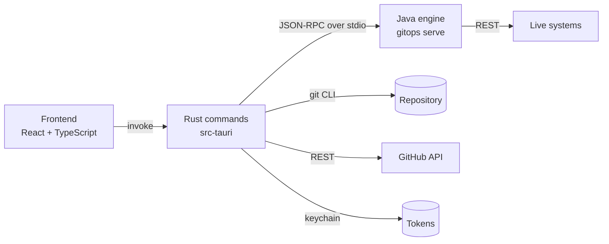

# GitOps desktop app

A window onto the GitOps engine: every target's state, what a plan would change, the config in Git and who
changed it, pull requests and drift on GitHub, and a way to propose changes that keeps Git the only way in.
What it does is described in the [main README](../README.md#desktop-app); this page is how it's built.

## Run it

```bash
npm install
npm run tauri dev       # builds ../build/engine (./gradlew engineBundle), then opens the app
```

You need Node.js 20+, Rust, Java 17+ for the build (Gradle downloads JDK 21), and on Linux WebKitGTK
(`libwebkit2gtk-4.1-dev` and friends, see [Tauri's prerequisites](https://tauri.app/start/prerequisites/)).
Open a clone of a GitOps repository: a folder with `config/<target>/target.json`.

| Command | What it does |
| --- | --- |
| `npm run tauri dev` | The app, reloading on frontend changes |
| `npm run dev` | The interface in a browser on **demo data** (labelled as such), no Rust or Java needed |
| `npm test` | Frontend tests (Vitest), including the contract test over the engine's fixtures |
| `npm run typecheck` | TypeScript |
| `cargo test` in `src-tauri/` | Rust tests; with `../build/engine` built, some drive the real engine |
| `cargo test -- --ignored live_github` | Reads this repository on github.com to check the GitHub field mapping |
| `npm run tauri build` | An installer, with the engine and its own Java runtime inside, so users need no Java |

## How it fits together



Each layer has one job, and none of them second-guesses another:

| Layer | Owns | Never does |
| --- | --- | --- |
| **Engine** (`../src`, run as `gitops serve`) | Validation, plans, plan ids, applies, reading and writing config files | UI, git, the GitHub API around the resources |
| **Rust** (`src-tauri/src`) | Starting and supervising the engine, tokens, watching files, git, GitHub pull requests, checks, runs and issues | Working out a diff |
| **Frontend** (`src/`) | Showing things and asking | Deciding whether something is valid or what would change |

The protocol between Rust and the engine is in [docs/engine-protocol.md](../docs/engine-protocol.md).

### Rust modules

| File | What it does |
| --- | --- |
| `engine.rs` | Finds the engine (`GITOPS_ENGINE_DIR`, the copy bundled with the app, or the repository's `build/engine`), starts it, matches responses to requests by id, forwards `apply.progress`, and fails every waiting call with the engine's last stderr lines if it dies. Refuses an engine whose JSON `schemaVersion` it doesn't know. |
| `lib.rs` | The commands the frontend may call, and the app state (one open repository and its engine). |
| `git.rs` | Status, diffs, history, discard and propose, through the `git` command. |
| `repo_check.rs` | Whether a folder can be opened, and if not why: inside a GitOps repository, no targets yet, or a regular project. |
| `github.rs` | Pull requests, checks, plan comments, drift issues, workflow runs and dispatch, cached by ETag. |
| `secrets.rs` | Tokens in the OS keychain. |
| `watcher.rs` | Watches `config/` and `.github/workflows/`, and reports bursts of changes once. |
| `settings.rs` | Recent repositories and which token names are stored (never the tokens). |

### Frontend

`src/lib` holds the pure parts, each with tests: `model.ts` (status, formatting, paths), `schemaForm.ts`
(form fields from a JSON Schema), `github.ts` (drift timeline, check summaries), `markdown.ts` (the plan
comment), `graph.ts` (the dependency graph's layout), `promote.ts` and `apply.ts`. `src/views` are the pages;
`state.tsx` holds the open repository and re-validates and re-plans the targets whose files changed.

`src/lib/demo.ts` stands in for the Rust side in a browser and in tests. Its dev plan is the engine's own
fixture, so the demo shows exactly what the engine returns.

## Safety

The app is built so that opening it, or clicking around, can't change a live system by surprise.

- **Git stays the way in.** Edits change the working tree only. Proposing commits just the chosen files to a
  new branch, pushes it and opens a pull request; your other edits stay where they were. The Plan, Apply and
  Drift workflows take it from there.
- **Applies are narrow.** Only targets with `"localApply": true` (the `dev` mock) can be applied from the app,
  only after typing the target's name, and only with the id of the plan on screen. If the live system moved
  since, the engine refuses with `plan_changed` and nothing is applied. Rust checks `localApply` and the plan
  id before the request leaves the app, and the engine checks them again.
- **One validator.** The form asks the engine (`resource.check`) as you type; only its answer enables Save,
  and `resource.write` refuses invalid resources and writes the canonical format.
- **Tokens never reach the page.** They live in the OS keychain. The frontend can set, clear and ask whether
  one is present; values go only to the engine (as environment variables, restarting it) and to GitHub.
- **A small surface.** Every command is listed in `build.rs` and granted in `capabilities/default.json`; the
  only plugin permission is the folder picker. The engine is reached through an allowlist of methods. Git runs
  with list arguments, paths limited to `config/`, `--` before paths, no prompts and a timeout. Only
  `https://github.com/` links can be opened. The CSP allows no remote scripts, styles, images or connections,
  and the Markdown of a plan comment is rendered as text, never as HTML.
- **Open repositories you trust.** A repository's `target.json` decides where the engine sends requests, as
  it does for the command line, and a target's `mock` makes **Start mock** run `npx json-server` (code from
  npm) on your machine. Nothing starts until you press it.
- **Tokens stay with their system.** A `rest` target never receives `GITHUB_TOKEN`; it gets only the token its
  `tokenEnv` names.
- **Notifications** are plain text sent through a Rust command; the page has no notification permission.

## Limits

- One repository at a time; one engine per repository.
- The drift watch runs only while the app is open (there's no tray or background service). For drift found
  while it's closed, rely on the daily Drift workflow and its issues (and `DRIFT_WEBHOOK_URL`).
- Pull requests, issues and runs are read from the first page (50 pull requests, 100 drift issues, the last
  21 drift runs). History in a shallow clone stops at the clone's depth.
- Starting a workflow and opening pull requests need `GITHUB_TOKEN` with access to the repository
  (Pull requests and Actions: write). Reading a public repository works without one, at GitHub's lower rate limit.
